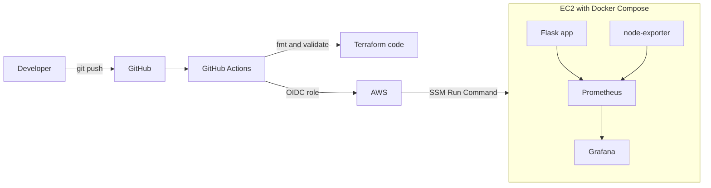

# aws-devops-platform

A small end-to-end DevOps project: a containerized Python app deployed to AWS with Terraform, shipped by GitHub Actions, and monitored with Prometheus and Grafana.

## What it does

`git push` to `main` runs CI, then GitHub deploys the new version to an EC2 server through AWS SSM. No SSH keys or AWS access keys are stored in GitHub.

## Architecture



## Tech stack

| Area | Tools |
|---|---|
| Cloud | AWS (VPC, EC2, IAM, S3, SSM) |
| Infrastructure as Code | Terraform (network module, S3 remote state with locking) |
| CI/CD | GitHub Actions with OIDC (no long-lived keys) |
| Containers | Docker, Docker Compose |
| Monitoring | Prometheus, Grafana, node-exporter |
| App | Python, Flask, Gunicorn |

## Security choices

- The security group only allows my own IP.
- GitHub assumes a short-lived AWS role limited to this repo's `main` branch and to running commands on one instance.
- IMDSv2 is required on the instance, and the disk is encrypted.
- State is stored in a private, versioned S3 bucket. Secrets, `.tfvars` and state files are git-ignored.

## Run it locally

```bash
git clone git@github.com:Harish0047/aws-devops-platform.git
cd aws-devops-platform
cp .env.example .env     # set your own Grafana password
docker compose up -d --build
```

App on :5000 (also /health and /metrics), Prometheus on :9090, Grafana on :3000.

## Deploy to AWS

```bash
cd terraform
cp terraform.tfvars.example terraform.tfvars   # set my_ip_cidr
terraform init && terraform apply
```

Then clone the repo on the server once, create its `.env`, and set the `AWS_ROLE_ARN` and `INSTANCE_ID` repo variables. Later pushes deploy automatically. Run `terraform destroy` when finished.

## Screenshots


## Problems I hit and how I fixed them

- (Your real problem 1: for example, the .gitignore file did not exist so git add failed with a pathspec error. I created the file first, then pushed.)
- (Your real problem 2, from Terraform, Docker or the pipeline.)
- (Your real problem 3.)

## Cost note

A t3.small server costs a small amount per hour. I run `terraform destroy` when I am not demoing and rebuild with one `terraform apply`.

## What I would improve next

- Use a narrower IAM policy for the deploy user, and add an application load balancer with HTTPS
- Add alerts with Alertmanager, and run containers from a registry image instead of building on the server
- Add `terraform plan` output as a comment on pull requests
